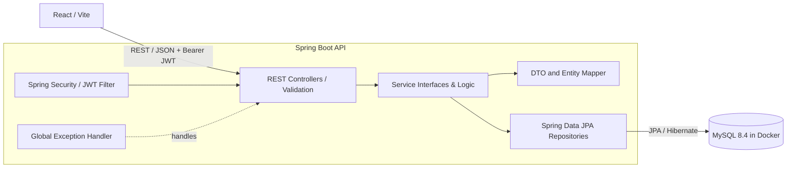

# Student Assignment Tracker

A full-stack application for managing student assignments, deadlines, submissions, courses, and academic progress with complete **Role-Based Access Control (RBAC)**.

## Table of contents

1. [Technology stack](#technology-stack)
2. [Architecture](#architecture)
3. [Project structure](#project-structure)
4. [Prerequisites](#prerequisites)
5. [Configuration](#configuration)
6. [Start and stop](#start-and-stop)
7. [Authentication and authorization](#authentication-and-authorization)
8. [Role-based workflows](#role-based-workflows)
9. [API reference](#api-reference)
10. [Database access](#database-access)
11. [Build and test](#build-and-test)
12. [Git setup](#git-setup)

## Technology stack

| Area | Technology |
| --- | --- |
| Frontend | React 19, Vite, React Router 7, Lucide React |
| Backend | Java 21 / 22, Spring Boot 3.5.16, Maven |
| Security | Spring Security 6, JWT (`io.jsonwebtoken` 0.13), BCrypt (12 rounds) |
| Persistence | Spring Data JPA, Hibernate, Flyway |
| Validation | Jakarta Bean Validation |
| Database | MySQL 8.4 in Docker |
| Utilities | Lombok |

## Architecture



Backend package responsibilities:

```text
com.studenttracker
|-- config          Framework, CORS, security, and demo seeding
|-- controller      REST controllers (Auth, Assignments, Teacher, Admin)
|-- dto             Validated request and response DTO records
|-- entity          JPA persistence models (User, Role, RoleName)
|-- exception       Domain errors and global exception handling
|-- mapper          Entity and DTO conversion
|-- repository      Spring Data persistence interfaces
|-- security        JWT service and Spring Security filter infrastructure
|-- service         Business service contracts
|   `-- impl        Service implementations (Auth, Assignments)
`-- util            Shared utilities
```

Architecture rules:

- Controllers accept and return validated DTOs; database entities are never exposed directly.
- Business logic is encapsulated in service implementations.
- Stateless authentication using HMAC-SHA256 signed JSON Web Tokens (`SessionCreationPolicy.STATELESS`).
- Method-level security via `@PreAuthorize` combined with URL-level security matchers.
- Flyway owns database migrations; Hibernate runs with `ddl-auto=validate`.

## Project structure

```text
student-assignment-tracker/
|-- backend/                  Spring Boot application
|   |-- .mvn/wrapper/         Maven Wrapper
|   |-- src/main/java/        Java source
|   |-- src/main/resources/   Configuration and Flyway migrations
|   |-- src/test/             Backend tests
|   |-- mvnw.cmd
|   `-- pom.xml
|-- src/                      React source
|   |-- components/           Re-usable components (ProtectedRoute, Brand, Avatar)
|   |-- pages/                Pages (LandingPage, LoginPage, DashboardPage, UnauthorizedPage)
|   `-- services/             authService (fetchWithAuth, login, logout, getSession)
|-- compose.yaml              MySQL 8.4 Docker service
|-- start-all.ps1             One-click stack start (Database + Backend + Frontend)
|-- stop-all.ps1              One-click stack stop
|-- start-backend.ps1         Start Spring Boot API (auto-loads .env & defaults)
|-- start-frontend.ps1        Start Vite dev server
|-- start-database.ps1        Start and healthcheck MySQL container
|-- stop-database.ps1         Stop MySQL container and preserve persistent volume
|-- package.json
`-- vite.config.js
```

## Prerequisites

- Docker Desktop (or another Docker-compatible engine)
- Java 21 or newer
- Node.js 20 LTS or newer with npm
- PowerShell 5.1 or newer

Maven does not need to be installed globally; the repository includes Maven Wrapper (`mvnw.cmd`).

## Configuration

### Service addresses

| Service | Address |
| --- | --- |
| Landing page | http://localhost:5173 |
| Login page | http://localhost:5173/login |
| Dashboard | http://localhost:5173/dashboard |
| Backend API | http://localhost:8081 |
| MySQL Host Port | `localhost:3307` |

### Database defaults

| Setting | Value |
| --- | --- |
| Database | `student_assignment_tracker` |
| Username | `tracker_app` |
| Password | `tracker_dev_password` |
| Host port | `3307` |
| Container port | `3306` |

Copy `.env.example` to `.env` to override Docker or backend defaults if needed.

## Start and stop

Run scripts from the project root directory:

```powershell
Set-Location E:\projects\student-assignment-tracker
```

### Start the complete stack (1 command)

```powershell
.\start-all.ps1
# or
npm start
```

This automatically:
1. Starts the Docker MySQL container and waits until healthy (`localhost:3307`).
2. Opens the Spring Boot API (`http://localhost:8081`).
3. Opens the Vite frontend (`http://localhost:5173`).
4. Tracks process IDs in `.run/` for clean termination.

### Stop the complete stack (1 command)

```powershell
.\stop-all.ps1
# or
npm run stop
```

Stops backend and frontend process trees and cleanly shuts down the database container while preserving the MySQL data volume.

### Start services individually

```powershell
.\start-database.ps1
.\start-backend.ps1
.\start-frontend.ps1
```

## Authentication and authorization

Authentication is database-backed and stateless. Passwords are encrypted with BCrypt (12 rounds) and successful authentication returns a signed JWT.

### Pre-configured demo accounts

Built-in demo accounts are seeded idempotently by `DemoUserInitializer` on backend startup:

| Role | Email | Password | Permissions |
| :--- | :--- | :--- | :--- |
| **Student** | `student@example.com` | `Student@123` | View coursework, submit work, undo submission, view grades |
| **Student 2** | `student2@example.com` | `Student@123` | Second student profile in database |
| **Teacher** | `teacher@example.com` | `Teacher@123` | Create assignments, delete assignments, grade student work |
| **Admin** | `admin@example.com` | `Admin@123` | Audit MySQL users, system status, all privileges |

On the Login screen (`http://localhost:5173/login`), **1-click Role Selector presets** are provided for instant switching during live demonstrations.

## Role-based workflows

### 1. Student Workflow
- **Browse Coursework**: View active course assignments, deadlines, and instructor information.
- **Submit Work**: Click **"Submit Work"** to provide repository URLs or solution notes. Status updates to `Submitted`.
- **Undo Submission**: If submitted coursework has not yet been evaluated by an instructor, the student can click **"Undo Submission"** to revert it back to `Pending` and adjust their submission.
- **View Grades & Remarks**: In the *My Submissions* tab, view evaluated grades (e.g. `28/30`) and teacher remarks.

### 2. Teacher Workflow
- **Publish Assignments**: Click **"+ Create Assignment"** in *Manage Assignments* to publish new coursework with title, course, and due date. The assignment immediately reflects in all student lists.
- **Grading Queue**: View submitted student work in *Grade Submissions*.
- **Grade & Feedback**: Click **"Grade Work"** to assign marks and instructor comments. The grade instantly syncs to the student's submission view.
- **Delete Assignment**: Remove assignments with confirmation.

### 3. Administrator Workflow
- **Database User Management**: The *User Management* tab queries the live Spring Boot endpoint `GET /api/admin/users` to fetch all accounts from the MySQL database with active roles.
- **Route & Access Protection**: Students or teachers attempting to access Admin endpoints or pages are denied with an HTTP 403 Forbidden notice.

## API reference

### Authentication

| Method | Endpoint | Authorization | Description |
| :--- | :--- | :--- | :--- |
| `POST` | `/api/auth/login` | Public | Authenticates credentials and returns JWT Bearer token |
| `GET` | `/api/auth/me` | Authenticated | Retrieves current authenticated user profile and roles |

### Assignments & Submissions

| Method | Endpoint | Authorization | Description |
| :--- | :--- | :--- | :--- |
| `GET` | `/api/assignments` | Authenticated | Retrieves all assignments, submission states, and grades |
| `POST` | `/api/assignments` | `ROLE_TEACHER`, `ROLE_ADMIN` | Creates and publishes a new assignment |
| `POST` | `/api/assignments/{id}/submit` | `ROLE_STUDENT`, `ROLE_ADMIN` | Submits solution text or repository link |
| `POST` | `/api/assignments/{id}/revert` | `ROLE_STUDENT`, `ROLE_ADMIN` | Undoes/reverts submission back to `Pending` |
| `POST` | `/api/assignments/{id}/grade` | `ROLE_TEACHER`, `ROLE_ADMIN` | Grades submission with score and instructor feedback |
| `DELETE` | `/api/assignments/{id}` | `ROLE_TEACHER`, `ROLE_ADMIN` | Deletes an assignment |

### Teacher Endpoints

| Method | Endpoint | Authorization | Description |
| :--- | :--- | :--- | :--- |
| `GET` | `/api/teacher/access-check` | `ROLE_TEACHER`, `ROLE_ADMIN` | Verifies teacher security privilege |
| `GET` | `/api/teacher/summary` | `ROLE_TEACHER`, `ROLE_ADMIN` | Retrieves active assignments and grading metrics |

### Admin Endpoints

| Method | Endpoint | Authorization | Description |
| :--- | :--- | :--- | :--- |
| `GET` | `/api/admin/access-check` | `ROLE_ADMIN` | Verifies administrator security privilege |
| `GET` | `/api/admin/summary` | `ROLE_ADMIN` | Retrieves system health and total user metrics |
| `GET` | `/api/admin/users` | `ROLE_ADMIN` | Returns all registered users from the MySQL database |

## Database access

Log into MySQL inside the running container:

```powershell
docker exec -it student-assignment-tracker-mysql mysql -u tracker_app -ptracker_dev_password student_assignment_tracker
```

Useful queries:

```sql
SHOW TABLES;
SELECT id, email, full_name, enabled FROM app_users;

-- View users with their assigned roles
SELECT 
    u.id, 
    u.email, 
    u.full_name, 
    r.name AS role
FROM app_users u
JOIN user_roles ur ON ur.user_id = u.id
JOIN roles r ON r.id = ur.role_id;

-- View Flyway migrations
SELECT installed_rank, version, description, success FROM flyway_schema_history;
```

Exit MySQL:
```sql
exit;
```

## Build and test

Frontend production build:
```powershell
npm run build
```

Backend test suite:
```powershell
Set-Location backend
.\mvnw.cmd test
```

Backend production package:
```powershell
Set-Location backend
.\mvnw.cmd clean package
```

The compiled executable JAR is generated under `backend/target/`.

## Git setup

```powershell
git status
git add .
git commit -m "Implement full-stack role-based authorization, assignment workflows, and documentation"
git push origin main
```
