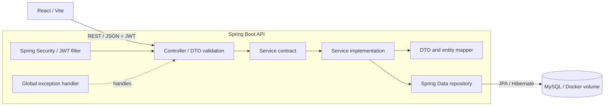

# Student Assignment Tracker

A full-stack application for managing student assignments, deadlines, submissions, courses, and academic progress.

## Table of contents

1. [Technology stack](#technology-stack)
2. [Architecture](#architecture)
3. [Project structure](#project-structure)
4. [Prerequisites](#prerequisites)
5. [Configuration](#configuration)
6. [Start and stop](#start-and-stop)
7. [Authentication and authorization](#authentication-and-authorization)
8. [API reference](#api-reference)
9. [Database access](#database-access)
10. [Build and test](#build-and-test)
11. [Git setup](#git-setup)

## Technology stack

| Area | Technology |
| --- | --- |
| Frontend | React, Vite, React Router, Lucide React |
| Backend | Java 21, Spring Boot 3.5.16, Maven |
| Security | Spring Security, JWT, BCrypt |
| Persistence | Spring Data JPA, Hibernate, Flyway |
| Validation | Jakarta Bean Validation |
| Database | MySQL 8.4 in Docker |
| Utilities | Lombok |

## Architecture



Backend package responsibilities:

```text
com.studenttracker
|-- config          Framework, CORS, security, and seed configuration
|-- controller      Thin REST controllers
|-- dto             Validated request and response contracts
|-- entity          JPA persistence models
|-- exception       Domain errors and global error handling
|-- mapper          Entity and DTO conversion
|-- repository      Spring Data persistence interfaces
|-- security        JWT and authenticated-user infrastructure
|-- service         Business service contracts
|   `-- impl        Business service implementations
`-- util            Small stateless shared utilities
```

Architecture rules:

- Controllers accept and return DTOs; entities are never exposed by APIs.
- Business logic belongs in service implementations.
- Services access repositories; controllers do not.
- Required dependencies use constructor injection.
- `spring.jpa.open-in-view=false` keeps persistence access out of the web layer.
- `ddl-auto=validate` validates mappings without changing the schema.
- Flyway owns all database schema changes.

## Project structure

```text
student-assignment-tracker/
|-- backend/                  Spring Boot application
|   |-- .mvn/wrapper/         Maven Wrapper
|   |-- src/main/java/        Java source
|   |-- src/main/resources/   Configuration and Flyway migrations
|   |-- src/test/             Backend tests
|   |-- mvnw.cmd
|   `-- pom.xml
|-- src/                      React source
|-- compose.yaml              MySQL service
|-- start-all.ps1             Start the complete stack
|-- stop-all.ps1              Stop the complete stack
|-- start-backend.ps1         Start Spring Boot
|-- start-frontend.ps1        Start Vite
|-- start-database.ps1        Start or verify MySQL
|-- stop-database.ps1         Stop MySQL and retain its volume
|-- package.json
`-- vite.config.js
```

## Prerequisites

- Docker Desktop or another Docker-compatible engine
- Java 21 or newer
- Node.js 20 LTS or newer with npm
- PowerShell 5.1 or newer

Maven does not need to be installed globally; the repository includes Maven Wrapper.

## Configuration

### Service addresses

| Service | Address |
| --- | --- |
| Landing page | http://localhost:5173 |
| Login | http://localhost:5173/login |
| Dashboard | http://localhost:5173/dashboard |
| Backend API | http://localhost:8081 |
| MySQL | `localhost:3307` |

### Database defaults

| Setting | Development value |
| --- | --- |
| Database | `student_assignment_tracker` |
| Username | `tracker_app` |
| Password | `tracker_dev_password` |
| Host port | `3307` |
| Container port | `3306` |

Copy `.env.example` to `.env` to override Docker values. The `.env` file is ignored by Git.

### Backend environment variables

| Variable | Default |
| --- | --- |
| `DB_HOST` | `localhost` |
| `DB_PORT` | `3307` |
| `DB_NAME` | `student_assignment_tracker` |
| `DB_USERNAME` | `tracker_app` |
| `DB_PASSWORD` | `tracker_dev_password` |
| `DB_POOL_SIZE` | `10` |
| `SERVER_PORT` | `8081` |
| `CORS_ALLOWED_ORIGINS` | `http://localhost:5173` |
| `JWT_EXPIRATION` | `PT8H` |
| `DEMO_USER_ENABLED` | `true` |

Use environment variables or a secret manager for deployed environments. Never deploy the development database password or JWT secret.

## Start and stop

Run scripts from the project root:

```powershell
Set-Location E:\projects\student-assignment-tracker
```

### Start the complete stack

```powershell
.\start-all.ps1
```

This starts or verifies MySQL, then opens separate backend and frontend PowerShell windows. PID files are stored under the ignored `.run` directory.

If Docker CLI is unavailable but MySQL is already reachable on port `3307`, startup continues safely.

### Stop the complete stack

```powershell
.\stop-all.ps1
```

This stops the frontend and backend process trees created by `start-all.ps1`, then stops the MySQL container. The named database volume is retained.

### Start services individually

```powershell
.\start-database.ps1
.\start-backend.ps1
.\start-frontend.ps1
```

Stop only MySQL:

```powershell
.\stop-database.ps1
```

Individual frontend/backend scripts are not PID-tracked by `stop-all.ps1`; close their PowerShell windows to stop them.

## Authentication and authorization

Authentication is database-backed and stateless. Passwords are stored as BCrypt hashes, and successful login returns an HMAC-signed JWT. The browser stores the session in `sessionStorage`, which is cleared when the tab is closed or the user logs out.

Development demo account:

```text
Email:    student@example.com
Password: Student@123
Role:     ROLE_STUDENT
```

The account is created idempotently on backend startup. Disable it outside local development:

```powershell
$env:DEMO_USER_ENABLED = 'false'
```

Provide a unique JWT secret of at least 32 bytes for deployed environments:

```powershell
$env:JWT_SECRET = 'replace-with-a-long-random-production-secret'
```

## API reference

| Method | Endpoint | Authorization |
| --- | --- | --- |
| `POST` | `/api/auth/login` | Public |
| `GET` | `/api/auth/me` | Bearer token |
| `GET` | `/api/admin/access-check` | `ROLE_ADMIN` |

Login example:

```powershell
$body = @{
  email = 'student@example.com'
  password = 'Student@123'
} | ConvertTo-Json

$login = Invoke-RestMethod `
  -Uri 'http://localhost:8081/api/auth/login' `
  -Method Post `
  -ContentType 'application/json' `
  -Body $body
```

Call an authenticated endpoint:

```powershell
$headers = @{ Authorization = "Bearer $($login.accessToken)" }
Invoke-RestMethod -Uri 'http://localhost:8081/api/auth/me' -Headers $headers
```

## Database access

Enter MySQL inside the container:

```powershell
docker exec -it student-assignment-tracker-mysql mysql -u tracker_app -ptracker_dev_password student_assignment_tracker
```

Useful queries:

```sql
SHOW TABLES;
DESCRIBE app_users;
DESCRIBE roles;
DESCRIBE user_roles;

SELECT
    u.id,
    u.email,
    u.full_name,
    u.enabled,
    r.name AS role
FROM app_users u
JOIN user_roles ur ON ur.user_id = u.id
JOIN roles r ON r.id = ur.role_id;
```

Exit MySQL:

```sql
exit;
```

### Add a local development student

This example copies the demo account's BCrypt hash, so the temporary password remains `Student@123`. Use a validated administration API instead of direct SQL in production.

```sql
INSERT INTO app_users (
    email, password_hash, full_name, enabled, created_at, updated_at
)
SELECT
    'student2@example.com',
    password_hash,
    'Second Student',
    TRUE,
    CURRENT_TIMESTAMP(6),
    CURRENT_TIMESTAMP(6)
FROM app_users
WHERE email = 'student@example.com';

SET @new_user_id = (
    SELECT id FROM app_users WHERE email = 'student2@example.com'
);

SET @student_role_id = (
    SELECT id FROM roles WHERE name = 'ROLE_STUDENT'
);

INSERT INTO user_roles (user_id, role_id)
VALUES (@new_user_id, @student_role_id);
```

## Build and test

Frontend production build:

```powershell
npm run build
```

Backend tests:

```powershell
Set-Location backend
.\mvnw.cmd test
```

Backend production package:

```powershell
Set-Location backend
.\mvnw.cmd clean package
```

The packaged JAR is generated under `backend/target/`.

## Git setup

Only use these commands when initializing a new local repository:

```powershell
git init
git add .
git commit -m "Initial commit"
git branch -M main
git remote add origin https://github.com/BhalchandraOP/Student-Assignment-Manager.git
git push -u origin main
```

## Current scope

- Responsive landing, login, and dashboard pages
- Database-backed JWT authentication
- Role-based backend authorization
- Dockerized MySQL with persistent storage and health checks
- Spring Boot layered architecture with Flyway migrations

Assignment-domain APIs and live dashboard data will be added one feature at a time.
