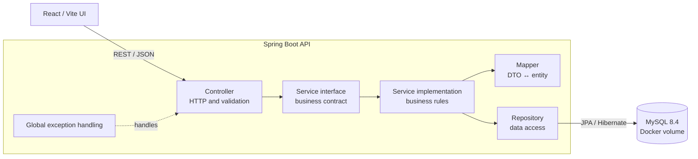

# Student Assignment Tracker

A production-oriented full-stack application for organizing student assignments, deadlines, submissions, courses, and academic progress.

## Technology stack

| Area | Technology |
|---|---|
| Frontend | React, Vite, React Router, Lucide React |
| Backend | Java 21, Spring Boot 3.5.16, Maven |
| Data access | Spring Data JPA, Hibernate |
| Validation | Jakarta Bean Validation |
| Database | MySQL 8.4 in Docker |
| Utilities | Lombok |

## Architecture



The backend package responsibilities are:

```text
com.studenttracker
├── config          cross-cutting framework configuration
├── controller      thin REST endpoints; no business logic
├── dto             validated request and response contracts
├── entity          JPA persistence models; never exposed by APIs
├── exception       domain errors and global exception handling
├── mapper          entity/DTO conversion
├── repository      Spring Data persistence interfaces
├── service         business contracts
│   └── impl        business implementations
└── util            small stateless shared utilities
```

Important boundaries:

- Controllers accept and return DTOs only.
- Business decisions belong in service implementations.
- Repositories are accessed by services, not controllers.
- Constructor injection is used for required dependencies.
- `spring.jpa.open-in-view=false` prevents persistence access from leaking into the web layer.
- `ddl-auto=validate` verifies mappings without silently changing the database schema.

## Project structure

```text
student-assignment-tracker/
├── backend/                     Spring Boot API
│   ├── .mvn/wrapper/            Maven Wrapper files
│   ├── src/main/java/           Java source
│   ├── src/main/resources/      application configuration
│   ├── src/test/                backend tests
│   ├── mvnw.cmd
│   └── pom.xml
├── src/                         React source
├── compose.yaml                 MySQL container definition
├── start-all.ps1                start the complete development stack
├── start-backend.ps1            start Spring Boot
├── start-database.ps1           start MySQL and wait for health
├── stop-database.ps1            stop MySQL without deleting data
├── start-frontend.ps1           start Vite
├── package.json
└── vite.config.js
```

## Prerequisites

- Docker Desktop with the Docker engine running
- Java 21 or newer (the project compiles to Java 21)
- Node.js 20 LTS or newer with npm
- PowerShell 5.1 or newer

Maven does not need to be installed globally because the backend includes Maven Wrapper.

## Quick start

From PowerShell in the project root:

```powershell
.\start-all.ps1
```

The script starts MySQL first, waits until it is healthy, then opens separate PowerShell windows for the backend and frontend.

| Service | Address |
|---|---|
| Frontend | http://localhost:5173 |
| Dashboard | http://localhost:5173/dashboard |
| Backend API | http://localhost:8081 |
| MySQL | localhost:3307 |

## Start services individually

Database:

```powershell
.\start-database.ps1
```

Backend:

```powershell
.\start-backend.ps1
```

Frontend:

```powershell
.\start-frontend.ps1
```

Stop the database container while retaining its volume:

```powershell
.\stop-database.ps1
```

To inspect database logs:

```powershell
docker compose logs -f mysql
```

## Local database configuration

The Docker development defaults are:

| Setting | Value |
|---|---|
| Host | `localhost` |
| Host port | `3307` |
| Container port | `3306` |
| Database | `student_assignment_tracker` |
| Application user | `tracker_app` |
| Application password | `tracker_dev_password` |

Copy `.env.example` to `.env` to override Docker values. `.env` is ignored by Git and must be used for non-development secrets.

The backend reads these environment variables:

| Variable | Default |
|---|---|
| `DB_HOST` | `localhost` |
| `DB_PORT` | `3307` |
| `DB_NAME` | `student_assignment_tracker` |
| `DB_USERNAME` | `tracker_app` |
| `DB_PASSWORD` | `tracker_dev_password` |
| `DB_POOL_SIZE` | `10` |
| `SERVER_PORT` | `8081` |
| `CORS_ALLOWED_ORIGINS` | `http://localhost:5173` |

Defaults are only for local development. Supply secrets through environment variables or a secret manager in deployed environments.

## Build and test

Frontend production build:

```powershell
npm run build
```

Backend tests:

```powershell
Set-Location backend
.\mvnw.cmd test
```

Backend production package:

```powershell
Set-Location backend
.\mvnw.cmd clean package
```

The packaged JAR is created under `backend/target/`.

## Current scope

- Responsive landing page
- Responsive dashboard page using local display data
- Dockerized MySQL with persistent storage and health checks
- Spring Boot backend foundation and database connectivity

Additional domain REST endpoints and frontend data integration will be added one feature at a time.

## Authentication and authorization

Authentication is database-backed and stateless. Passwords are stored as BCrypt hashes and successful login returns an HMAC-signed JWT. Flyway owns the `app_users`, `roles`, and `user_roles` schema.

Demo student credentials for local development:

```text
Email:    student@example.com
Password: Student@123
Role:     ROLE_STUDENT
```

The demo account is created idempotently during backend startup. Its plaintext password is never written to the database. Disable or replace it outside local development with `DEMO_USER_ENABLED=false`.

| Method | Endpoint | Access |
|---|---|---|
| `POST` | `/api/auth/login` | Public |
| `GET` | `/api/auth/me` | Authenticated bearer token |
| `GET` | `/api/admin/access-check` | `ROLE_ADMIN` only |

Login example:

```powershell
$body = @{
  email = 'student@example.com'
  password = 'Student@123'
} | ConvertTo-Json

$login = Invoke-RestMethod `
  -Uri 'http://localhost:8081/api/auth/login' `
  -Method Post `
  -ContentType 'application/json' `
  -Body $body
```

Use the returned access token:

```powershell
$headers = @{ Authorization = "Bearer $($login.accessToken)" }
Invoke-RestMethod -Uri 'http://localhost:8081/api/auth/me' -Headers $headers
```

For deployments, provide a unique random `JWT_SECRET` of at least 32 bytes. The development default must not be used in production. The browser keeps the token in `sessionStorage`, so closing the tab clears the local session.

## Git initial commands
cd "E:\projects\student-assignment-tracker>" git init

git add .

git commit -m "Initial commit"

git branch -M main

git remote add origin https://github.com/BhalchandraOP/Student-Assignment-Manager.git

git push -u origin main